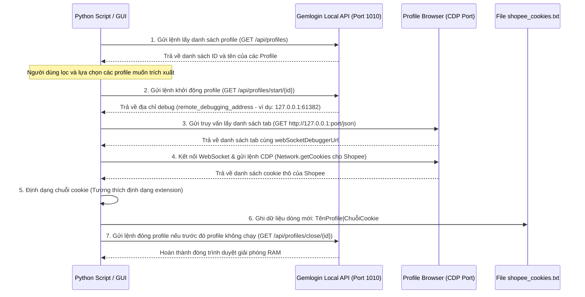
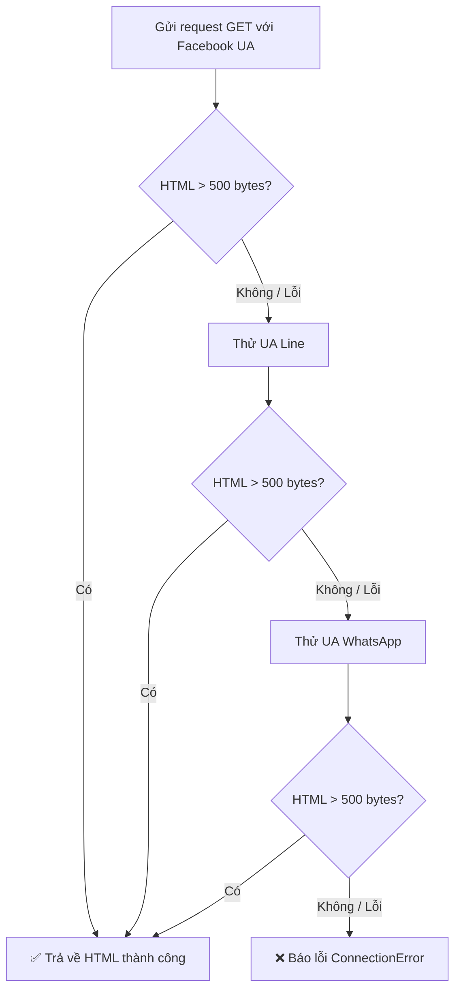

# Tài liệu chi tiết: Hệ thống tự động trích xuất Cookie Shopee từ Gemlogin

Tài liệu này tổng hợp toàn bộ quy trình, thuật toán, thông tin kỹ thuật và toàn bộ mã nguồn của hệ thống trích xuất cookie tự động cho Gemlogin.

---

## 1. Quy trình & Luồng hoạt động (Process Flow)

Hệ thống hoạt động dựa trên sự kết hợp giữa máy chủ API cục bộ của Gemlogin và giao thức gỡ lỗi Chromium DevTools Protocol (CDP).



### Các bước thực thi chi tiết:
1.  **Phát hiện trạng thái tiến trình:** Script dùng lệnh hệ thống (PowerShell/CIM) quét các trình duyệt `chrome.exe` đang chạy của Gemlogin trên máy. Việc này giúp xác định những profile nào đang được người dùng mở sẵn để làm việc. Đối với các profile này, script sẽ lấy cookie và **không tự động đóng** để tránh mất dữ liệu của người dùng.
2.  **Khởi chạy theo lô (Batching):** Đối với các profile đang đóng, script sẽ mở đồng thời tối đa `N` profile (cấu hình qua tham số `batch`, mặc định là 5) để tránh quá tải tài nguyên hệ thống (CPU/RAM).
3.  **Khởi động qua API Gemlogin:** Gửi yêu cầu HTTP đến API cục bộ `http://127.0.0.1:1010/api/profiles/start/{id}`. Nếu profile đã mở sẵn, API trả về ngay lập tức cổng debug hiện tại. Nếu chưa mở, Gemlogin sẽ tự chạy profile và trả về cổng debug mới.
4.  **Bỏ qua xác thực nguồn gốc (Origin):** Do Chromium kiểm soát bảo mật WebSocket nguồn (Origin), khi kết nối bằng thư viện `websocket-client` trong Python, ta cần sử dụng cờ `suppress_origin=True` để tránh lỗi `403 Forbidden`.
5.  **Giao thức CDP (Chrome DevTools Protocol):**
    *   Sử dụng phương thức `Network.getCookies` kèm tham số bộ lọc các tên miền Shopee để lấy chính xác danh sách cookie Shopee hiện tại.
    *   Sử dụng phương thức `Browser.getVersion` để lấy chuỗi `UserAgent` thực tế của profile trình duyệt nhằm đồng bộ hóa khi cấu hình chạy tool bên ngoài.
6.  **Đóng trình duyệt tự động:** Gửi yêu cầu đến `http://127.0.0.1:1010/api/profiles/close/{id}` đối với những profile được script tự động mở lên sau khi đã trích xuất xong cookie.

---

## 2. Thông tin kỹ thuật & API Endpoints

### API Cục bộ của Gemlogin
*   **Địa chỉ mặc định:** `http://127.0.0.1:1010` (hoặc cổng cấu hình trong Electron app).
*   **Endpoints sử dụng:**
    *   `GET /api/profiles`: Lấy danh sách tất cả các profile (bao gồm `id`, `name`, `profile_path`, v.v.).
    *   `GET /api/profiles/start/{id}`: Chạy trình duyệt của profile có `id`. Trả về JSON chứa `remote_debugging_address` (địa chỉ IP và cổng debug, ví dụ `127.0.0.1:61382`).
    *   `GET /api/profiles/close/{id}`: Đóng trình duyệt của profile có `id`.

### Giao thức gỡ lỗi trình duyệt (CDP)
*   **Lấy danh sách tab:** `GET http://127.0.0.1:{port}/json`
*   **Gửi lệnh WebSocket:**
    *   **Lấy Cookie:**
        ```json
        {
          "id": 1,
          "method": "Network.getCookies",
          "params": {
            "urls": ["https://shopee.vn", "https://shopee.com.my", "https://shopee.ph", "https://shopee.tw", "https://shopee.co.th", "https://shopee.co.id"]
          }
        }
        ```
    *   **Lấy User Agent:**
        ```json
        {
          "id": 2,
          "method": "Browser.getVersion",
          "params": {}
        }
        ```

### Định dạng chuỗi cookie đầu ra:
Định dạng chuỗi cookie được ghép chuẩn xác tương thích 100% với extension Chrome của bạn:
1.  Đưa `csrftoken=<giá trị>` lên vị trí đầu tiên (nếu có).
2.  Ghép các cookie khác theo định dạng `name=value` phân tách bằng dấu chấm phẩy `; `.
3.  Tự động bổ sung các chuỗi thông số phiên bản app của Shopee ở cuối: `; language=en; SPC_RNBV=6073008; shopee_app_version=29627; shopee_rn_bundle_version=6073008; shopee_rn_version=1671807778`

---

## 3. Thuật Toán Bypass Anti-Bot Shopee (Bản chất & Phương pháp giả lập)

Cơ chế bypass anti-bot này được tham khảo từ phần mềm **Shopee Image Downloader v2.0**, giúp hiểu rõ bản chất bảo mật của Shopee và cách vượt qua hiệu quả khi gửi request trực tiếp không thông qua trình duyệt:

### 3.1 Bản chất vấn đề bảo mật của Shopee
Shopee áp dụng cơ chế chống thu thập dữ liệu (anti-scraping) rất nghiêm ngặt đối với các request trực tiếp:
*   **Kiểm tra User-Agent:** Tự động chặn các User-Agent của thư viện crawl mặc định như Python `requests`, Selenium, Puppeteer...
*   **Kiểm tra TLS Fingerprint:** Phát hiện cấu trúc bắt tay SSL/TLS của các HTTP client không phải trình duyệt thông thường.
*   *Hậu quả:* Trình duyệt bot sẽ nhận về trang trống hoặc trang Captcha yêu cầu xác thực.

### 3.2 Giải pháp: Giả lập Crawler Mạng Xã Hội (Social Crawler Emulation)
*   **Phát hiện mấu chốt:** Shopee luôn cho phép các robot crawler của các mạng xã hội lớn như **Facebook, WhatsApp, Line** truy cập không hạn chế vào liên kết sản phẩm nhằm lấy thông tin xem trước (link preview / Open Graph).
*   Giả lập các User-Agent của mạng xã hội này giúp lấy về mã nguồn HTML chứa đầy đủ thông tin sản phẩm (tên, hình ảnh, thông số...) mà không bị hệ thống anti-bot chặn lại.

### 3.3 Chuỗi User-Agent giả lập (Fallback Chain)
Hệ thống sử dụng cơ chế thử lỗi và chuyển tiếp User-Agent như sau:



#### Danh sách các User-Agent tương ứng:
1.  **Facebook UA (Chính):** `facebookexternalhit/1.1 (+http://www.facebook.com/externalhit_uatext.php)`
2.  **Line UA (Dự phòng 1):** `facebookexternalhit/1.1;line-poker/1.0`
3.  **WhatsApp UA (Dự phòng 2):** `WhatsApp/2.21.12.21 A`

### 3.4 Cấu hình Request Headers gửi kèm
```python
{
    "User-Agent": "<User-Agent mạng xã hội tương ứng>",
    "Accept": "text/html,application/xhtml+xml,application/xml;q=0.9,*/*;q=0.8",
    "Accept-Language": "en-US,en;q=0.5",
    "Accept-Encoding": "identity",
}
```
> [!NOTE]
> Việc cấu hình `"Accept-Encoding": "identity"` yêu cầu máy chủ Shopee trả về HTML thô không nén (gzip/brotli), giúp đơn giản hóa việc giải mã nội dung trong code Python.

---

## 4. Toàn bộ mã nguồn hệ thống

### 4.1 Script chạy dòng lệnh (CLI): `get_gemlogin_cookies.py`

```python
import json
import urllib.request
import urllib.error
import subprocess
import re
import time
import csv
import sys
import os
from datetime import datetime

# Cấu hình mã hóa đầu ra hỗ trợ ký tự tiếng Việt Unicode trên terminal Windows
if hasattr(sys.stdout, 'reconfigure'):
    sys.stdout.reconfigure(encoding='utf-8')
if hasattr(sys.stderr, 'reconfigure'):
    sys.stderr.reconfigure(encoding='utf-8')

# Import thư viện websocket kết nối CDP
try:
    import websocket
except ImportError:
    print("Error: Thư viện 'websocket-client' là bắt buộc. Vui lòng cài đặt bằng lệnh: pip install websocket-client")
    sys.exit(1)

# Địa chỉ API mặc định
GEMLOGIN_API = "http://127.0.0.1:1010"

# Danh sách tên miền Shopee cần lấy
SHOPEE_DOMAINS = [
    "shopee.vn",
    "shopee.com.my",
    "shopee.ph",
    "shopee.tw",
    "shopee.co.th",
    "shopee.co.id"
]

# Chuỗi cookie bổ sung tương tự extension
ADDITIONAL_COOKIES = '; language=en; SPC_RNBV=6073008; shopee_app_version=29627; shopee_rn_bundle_version=6073008; shopee_rn_version=1671807778'

def get_running_profiles():
    """
    Quét danh sách các profile hiện đang chạy trên hệ thống thông qua kiểm tra lệnh chrome.exe.
    Trả về một set chứa các ID profile đang mở.
    """
    running_ids = set()
    try:
        cmd = 'powershell -NoProfile -ExecutionPolicy Bypass -Command "Get-CimInstance Win32_Process -Filter \\"name=\'chrome.exe\'\\" | Select-Object CommandLine | ConvertTo-Json"'
        result = subprocess.run(cmd, shell=True, capture_output=True, text=True, encoding='utf-8')
        
        stdout = result.stdout.strip()
        if not stdout:
            return running_ids
            
        data = json.loads(stdout)
        if isinstance(data, dict):
            data = [data]
            
        for item in data:
            cmdline = item.get('CommandLine') or ''
            match = re.search(r'--user-data-dir=["\']?.*profiles[\\/](\d+)["\']?', cmdline)
            if match:
                running_ids.add(int(match.group(1)))
    except Exception as e:
        print(f"Cảnh báo: Không thể quét các profile đang mở bằng PowerShell: {e}")
    return running_ids

def api_get_profiles():
    """Lấy danh sách tất cả các profile từ API cục bộ"""
    url = f"{GEMLOGIN_API}/api/profiles"
    try:
        req = urllib.request.Request(url)
        with urllib.request.urlopen(req, timeout=5) as response:
            res = json.loads(response.read().decode('utf-8'))
            if res.get('success'):
                return res.get('data', [])
            else:
                print(f"API Lỗi: {res.get('message')}")
    except Exception as e:
        print(f"Lỗi kết nối tới Gemlogin API tại {GEMLOGIN_API}: {e}")
        print("Vui lòng mở ứng dụng Gemlogin.")
    return []

def api_start_profile(profile_id):
    """Gửi lệnh mở profile"""
    url = f"{GEMLOGIN_API}/api/profiles/start/{profile_id}"
    try:
        req = urllib.request.Request(url)
        with urllib.request.urlopen(req, timeout=15) as response:
            res = json.loads(response.read().decode('utf-8'))
            if res.get('success') and 'data' in res:
                return res['data'].get('remote_debugging_address'), res['data'].get('driver_path')
    except Exception as e:
        print(f"Lỗi mở profile {profile_id}: {e}")
    return None, None

def api_close_profile(profile_id):
    """Gửi lệnh đóng profile"""
    url = f"{GEMLOGIN_API}/api/profiles/close/{profile_id}"
    try:
        req = urllib.request.Request(url)
        with urllib.request.urlopen(req, timeout=10) as response:
            res = json.loads(response.read().decode('utf-8'))
            return res.get('success', False)
    except Exception as e:
        print(f"Lỗi đóng profile {profile_id}: {e}")
    return False

def get_websocket_url(debug_addr):
    """Lấy WebSocket Debugger URL từ danh sách target JSON"""
    url = f"http://{debug_addr}/json"
    for attempt in range(5):
        try:
            req = urllib.request.Request(url)
            with urllib.request.urlopen(req, timeout=3) as response:
                targets = json.loads(response.read().decode('utf-8'))
                for target in targets:
                    if target.get('type') == 'page':
                        return target.get('webSocketDebuggerUrl')
        except Exception:
            time.sleep(1)
    return None

def extract_cookies_via_cdp(ws_url):
    """Kết nối và gửi lệnh CDP lấy cookie & User Agent"""
    cookies_list = []
    user_agent = None
    
    try:
        # Get cookies
        ws = websocket.create_connection(ws_url, suppress_origin=True, timeout=10)
        shopee_urls = [f"https://{domain}" for domain in SHOPEE_DOMAINS]
        cmd = {
            "id": 1,
            "method": "Network.getCookies",
            "params": {
                "urls": shopee_urls
            }
        }
        ws.send(json.dumps(cmd))
        res = json.loads(ws.recv())
        cookies_list = res.get('result', {}).get('cookies', [])
        ws.close()
        
        # Check if csrftoken is missing
        has_csrf = any(c.get('name') == 'csrftoken' for c in cookies_list)
        if not has_csrf:
            # Force populate csrftoken by loading Shopee in a background tab
            try:
                # Find the shopee domain we have cookies for (default shopee.vn)
                target_domain = "shopee.vn"
                for c in cookies_list:
                    d = c.get('domain', '').lstrip('.')
                    for shopee_d in SHOPEE_DOMAINS:
                        if d == shopee_d or d.endswith('.' + shopee_d):
                            target_domain = shopee_d
                            break
                
                ws = websocket.create_connection(ws_url, suppress_origin=True, timeout=10)
                # Create a background tab
                create_cmd = {
                    "id": 10,
                    "method": "Target.createTarget",
                    "params": {
                        "url": f"https://{target_domain}"
                    }
                }
                ws.send(json.dumps(create_cmd))
                res_create = json.loads(ws.recv())
                target_id = res_create.get('result', {}).get('targetId')
                
                if target_id:
                    # Wait for background tab to load and apply cookies
                    time.sleep(5)
                    
                    # Close background tab
                    close_cmd = {
                        "id": 11,
                        "method": "Target.closeTarget",
                        "params": {
                            "targetId": target_id
                        }
                    }
                    ws.send(json.dumps(close_cmd))
                    ws.recv()
                    
                    # Re-fetch cookies
                    ws.send(json.dumps(cmd))
                    res_refetch = json.loads(ws.recv())
                    cookies_list = res_refetch.get('result', {}).get('cookies', [])
                ws.close()
            except Exception as e:
                print(f"Failed to force populate csrftoken via background tab: {e}")
                
    except Exception as e:
        print(f"CDP cookie extraction error: {e}")
        
    try:
        # Get User Agent
        ws = websocket.create_connection(ws_url, suppress_origin=True, timeout=10)
        cmd_ua = {
            "id": 2,
            "method": "Browser.getVersion",
            "params": {}
        }
        ws.send(json.dumps(cmd_ua))
        res_ua = json.loads(ws.recv())
        user_agent = res_ua.get('result', {}).get('userAgent')
        ws.close()
    except Exception:
        pass
        
    return cookies_list, user_agent

def format_cookies(cookies_list):
    """Định dạng cookie theo chuẩn và gộp theo tên miền quốc gia"""
    domain_cookies = {}
    
    for cookie in cookies_list:
        domain = cookie.get('domain', '')
        norm_domain = domain.lstrip('.')
        
        matched_domain = None
        for d in SHOPEE_DOMAINS:
            if norm_domain == d or norm_domain.endswith('.' + d):
                matched_domain = d
                break
                
        if not matched_domain:
            continue
            
        if matched_domain not in domain_cookies:
            domain_cookies[matched_domain] = []
            
        domain_cookies[matched_domain].append(cookie)
        
    formatted_results = {}
    for domain, cookies in domain_cookies.items():
        csrf_token = None
        other_cookies = []
        is_logged_in = False
        
        for c in cookies:
            name = c.get('name')
            value = c.get('value')
            if name == 'csrftoken':
                csrf_token = value
            else:
                other_cookies.append(f"{name}={value}")
                
            if name in ['SPC_EC', 'SPC_U']:
                is_logged_in = True
                
        cookie_str = ""
        if csrf_token:
            cookie_str += f"csrftoken={csrf_token}; "
        cookie_str += "; ".join(other_cookies)
        cookie_str += ADDITIONAL_COOKIES
        
        formatted_results[domain] = (cookie_str, is_logged_in)
        
    return formatted_results

def main():
    import argparse
    parser = argparse.ArgumentParser(description="Tự động trích xuất Cookie Shopee từ các profile Gemlogin.")
    parser.add_argument("--limit", type=int, default=0, help="Giới hạn số lượng profile xử lý (0 = tất cả).")
    parser.add_argument("--batch", type=int, default=5, help="Số lượng profile mở đồng thời tối đa.")
    parser.add_argument("--output", type=str, default="shopee_cookies.txt", help="Tên file lưu kết quả (.txt hoặc .csv).")
    args = parser.parse_args()

    print("=== Tool Lấy Cookie Shopee tự động từ Gemlogin ===")
    print(f"Quét API Gemlogin tại: {GEMLOGIN_API}")
    
    profiles = api_get_profiles()
    if not profiles:
        print("Không có profile nào được tìm thấy hoặc không thể kết nối tới Gemlogin API.")
        return
        
    print(f"Đã tìm thấy tổng cộng {len(profiles)} profile.")
    
    if args.limit > 0:
        profiles = profiles[:args.limit]
        print(f"Chỉ xử lý giới hạn {args.limit} profile đầu tiên.")
        
    running_before = get_running_profiles()
    print(f"Phát hiện {len(running_before)} profile đang chạy sẵn trên máy: {list(running_before)}")
    
    is_txt = args.output.endswith('.txt')
    file_exists = os.path.exists(args.output)
    
    if is_txt:
        txt_file = open(args.output, mode="w", encoding="utf-8")
    else:
        csv_file = open(args.output, mode="w", encoding="utf-8", newline="")
        csv_writer = csv.writer(csv_file)
        csv_writer.writerow(["Profile ID", "Profile Name", "Domain", "Status", "Cookie", "User Agent", "Exported At"])

    processed_count = 0
    success_count = 0
    
    batch_size = args.batch
    for i in range(0, len(profiles), batch_size):
        batch = profiles[i:i+batch_size]
        print(f"\n--- Đang xử lý nhóm profile {i+1} đến {min(i+batch_size, len(profiles))} ---")
        
        opened_in_batch = []
        
        for p in batch:
            p_id = p['id']
            p_name = p['name']
            
            is_already_running = p_id in running_before
            status_str = "đang chạy sẵn" if is_already_running else "đang đóng, đang mở..."
            print(f"Profile [{p_id}] {p_name} ({status_str})")
            
            addr, _ = api_start_profile(p_id)
            if addr:
                opened_in_batch.append({
                    "id": p_id,
                    "name": p_name,
                    "addr": addr,
                    "already_running": is_already_running
                })
            else:
                print(f"❌ Không thể khởi động profile [{p_id}] {p_name}")
                
        time.sleep(2)
        
        for item in opened_in_batch:
            p_id = item['id']
            p_name = item['name']
            addr = item['addr']
            
            print(f"-> Đang kết nối tới [{p_id}] {p_name} ({addr})...")
            ws_url = get_websocket_url(addr)
            if not ws_url:
                print(f"❌ Không lấy được WebSocket cho [{p_id}] {p_name}")
                continue
                
            cookies_list, ua = extract_cookies_via_cdp(ws_url)
            if not cookies_list:
                print(f"⚠️ Không tìm thấy cookie Shopee nào trong [{p_id}] {p_name}")
                continue
                
            formatted = format_cookies(cookies_list)
            if not formatted:
                print(f"⚠️ Không tìm thấy cookie khớp tên miền Shopee trong [{p_id}] {p_name}")
                continue
                
            for domain, (cookie_str, logged_in) in formatted.items():
                if is_txt:
                    txt_file.write(f"{p_name}|{cookie_str}\n")
                    print(f"   ✅ Đã lấy cookie [{domain}] -> Dạng text ({p_name}|...)")
                else:
                    login_status = "Logged In" if logged_in else "Not Logged In"
                    csv_writer.writerow([
                        p_id,
                        p_name,
                        domain,
                        login_status,
                        cookie_str,
                        ua or "",
                        datetime.now().strftime("%Y-%m-%d %H:%M:%S")
                    ])
                    print(f"   ✅ Đã lấy cookie [{domain}] [{login_status}]")
                
            success_count += 1
            if is_txt:
                txt_file.flush()
            else:
                csv_file.flush()
            
        for item in opened_in_batch:
            p_id = item['id']
            p_name = item['name']
            if not item['already_running']:
                print(f"<- Đang tự động đóng profile [{p_id}] {p_name}...")
                api_close_profile(p_id)
                time.sleep(0.5)
                
        processed_count += len(batch)
        
    if is_txt:
        txt_file.close()
    else:
        csv_file.close()
        
    print(f"\n=== Hoàn thành! ===")
    print(f"Đã xử lý: {processed_count} profile.")
    print(f"Thành công trích xuất: {success_count} profile.")
    print(f"Kết quả được lưu tại: {os.path.abspath(args.output)}")

if __name__ == "__main__":
    main()
```

---

### 4.2 Giao diện đồ họa người dùng (GUI): `gui.py`

```python
import tkinter as tk
from tkinter import ttk, messagebox, filedialog
import threading
import queue
import time
import os
import csv
import sys
from datetime import datetime

# Import local modules
import get_gemlogin_cookies as extractor

# Cấu hình mã hóa đầu ra hỗ trợ ký tự tiếng Việt Unicode
if hasattr(sys.stdout, 'reconfigure'):
    sys.stdout.reconfigure(encoding='utf-8')
if hasattr(sys.stderr, 'reconfigure'):
    sys.stderr.reconfigure(encoding='utf-8')

# Bảng màu giao diện tối (Dark Mode Theme)
BG_DARK = "#121212"
BG_CARD = "#1e1e1e"
BG_HOVER = "#2a2a2a"
ACCENT_ORANGE = "#ee4d2d"  # Shopee Orange
TEXT_WHITE = "#ffffff"
TEXT_GRAY = "#aaaaaa"
STATUS_READY = "#888888"
STATUS_RUNNING = "#ffaa00"
STATUS_SUCCESS = "#4caf50"
STATUS_ERROR = "#f44336"

class ProfileRow:
    """Widget đại diện cho 1 hàng profile trong danh sách chọn"""
    def __init__(self, parent, profile, on_change_callback):
        self.profile = profile
        self.id = profile['id']
        self.name = profile['name']
        self.profile_path = profile.get('profile_path', '')
        
        self.frame = tk.Frame(parent, bg=BG_CARD, height=35)
        self.frame.pack(fill=tk.X, pady=1)
        self.frame.pack_propagate(False)
        
        self.var = tk.BooleanVar(value=False)
        self.cb = tk.Checkbutton(
            self.frame, 
            variable=self.var, 
            bg=BG_CARD, 
            activebackground=BG_CARD,
            selectcolor="#ffffff",
            command=on_change_callback
        )
        self.cb.pack(side=tk.LEFT, padx=10)
        
        self.id_lbl = tk.Label(
            self.frame, 
            text=f"#{self.id}", 
            fg=TEXT_GRAY, 
            bg=BG_CARD, 
            font=("Arial", 10, "bold"),
            width=6,
            anchor="w"
        )
        self.id_lbl.pack(side=tk.LEFT, padx=5)
        
        self.name_lbl = tk.Label(
            self.frame, 
            text=self.name, 
            fg=TEXT_WHITE, 
            bg=BG_CARD, 
            font=("Arial", 10),
            anchor="w"
        )
        self.name_lbl.pack(side=tk.LEFT, fill=tk.X, expand=True, padx=5)
        
        self.sys_status = "Đóng"
        self.sys_lbl = tk.Label(
            self.frame,
            text=self.sys_status,
            fg=STATUS_READY,
            bg=BG_DARK,
            font=("Arial", 9),
            padx=6,
            pady=2
        )
        self.sys_lbl.pack(side=tk.RIGHT, padx=10)
        
        self.status = "Sẵn sàng"
        self.status_lbl = tk.Label(
            self.frame, 
            text=self.status, 
            fg=STATUS_READY, 
            bg=BG_CARD, 
            font=("Arial", 9, "bold"),
            width=12,
            anchor="center"
        )
        self.status_lbl.pack(side=tk.RIGHT, padx=10)
        
        self.frame.bind("<Enter>", lambda e: self.on_hover(True))
        self.frame.bind("<Leave>", lambda e: self.on_hover(False))
        
    def on_hover(self, is_hover):
        color = BG_HOVER if is_hover else BG_CARD
        self.frame.config(bg=color)
        self.cb.config(bg=color, activebackground=color)
        self.id_lbl.config(bg=color)
        self.name_lbl.config(bg=color)
        self.status_lbl.config(bg=color)
        
    def set_status(self, text, color):
        self.status = text
        self.status_lbl.config(text=text, fg=color)
        
    def set_sys_status(self, is_running):
        if is_running:
            self.sys_lbl.config(text="Đang Chạy", fg=STATUS_RUNNING, bg="#332200")
        else:
            self.sys_lbl.config(text="Đóng", fg=STATUS_READY, bg=BG_DARK)

class GemloginCookieGUI:
    def __init__(self, root):
        self.root = root
        self.root.title("GemLogin Cookie Extractor - Shopee Edition")
        self.root.geometry("1100x750")
        self.root.configure(bg=BG_DARK)
        
        self.profiles = []
        self.profile_rows = {}
        self.running_ids_before = set()
        self.is_extracting = False
        self.stop_requested = False
        self.ui_update_queue = queue.Queue()
        
        self.style = ttk.Style()
        self.style.theme_use('clam')
        self.style.configure(".", background=BG_DARK, foreground=TEXT_WHITE)
        self.style.configure("TProgressbar", thickness=15, troughcolor=BG_CARD, background=ACCENT_ORANGE)
        
        self.setup_ui()
        self.load_profiles()
        
        self.root.after(100, self.process_ui_queue)
        
    def setup_ui(self):
        # Banner trên cùng
        self.banner = tk.Frame(self.root, bg=ACCENT_ORANGE, height=60)
        self.banner.pack(fill=tk.X)
        self.banner.pack_propagate(False)
        
        banner_title = tk.Label(
            self.banner, 
            text="GEMLOGIN COOKIE EXTRACTOR", 
            fg=TEXT_WHITE, 
            bg=ACCENT_ORANGE, 
            font=("Arial", 16, "bold")
        )
        banner_title.pack(side=tk.LEFT, padx=20, pady=15)
        
        banner_subtitle = tk.Label(
            self.banner, 
            text="Shopee Auto-Extractor Edition v1.0", 
            fg="#ffd2cc", 
            bg=ACCENT_ORANGE, 
            font=("Arial", 10, "italic")
        )
        banner_subtitle.pack(side=tk.RIGHT, padx=20, pady=20)
        
        self.container = tk.Frame(self.root, bg=BG_DARK)
        self.container.pack(fill=tk.BOTH, expand=True, padx=15, pady=15)
        
        # --- LEFT PANEL: Control & Configuration ---
        self.left_panel = tk.Frame(self.container, bg=BG_CARD, width=320, padx=15, pady=15)
        self.left_panel.pack(side=tk.LEFT, fill=tk.Y, padx=(0, 10))
        self.left_panel.pack_propagate(False)
        
        config_title = tk.Label(
            self.left_panel, 
            text="CẤU HÌNH BATCH", 
            fg=ACCENT_ORANGE, 
            bg=BG_CARD, 
            font=("Arial", 11, "bold")
        )
        config_title.pack(anchor="w", pady=(0, 10))
        
        # Batch size
        tk.Label(self.left_panel, text="Số luồng chạy đồng thời (Batch Size):", fg=TEXT_GRAY, bg=BG_CARD, font=("Arial", 9)).pack(anchor="w")
        self.batch_entry = tk.Entry(self.left_panel, bg="#2d2d2d", fg=TEXT_WHITE, insertbackground=TEXT_WHITE, borderwidth=0, font=("Arial", 10))
        self.batch_entry.insert(0, "5")
        self.batch_entry.pack(fill=tk.X, pady=(2, 10), ipady=5)
        
        # Delay size
        tk.Label(self.left_panel, text="Độ trễ giữa các profile (Giây):", fg=TEXT_GRAY, bg=BG_CARD, font=("Arial", 9)).pack(anchor="w")
        self.delay_entry = tk.Entry(self.left_panel, bg="#2d2d2d", fg=TEXT_WHITE, insertbackground=TEXT_WHITE, borderwidth=0, font=("Arial", 10))
        self.delay_entry.insert(0, "1")
        self.delay_entry.pack(fill=tk.X, pady=(2, 10), ipady=5)
        
        # Output File Path
        tk.Label(self.left_panel, text="File xuất kết quả (TXT/CSV):", fg=TEXT_GRAY, bg=BG_CARD, font=("Arial", 9)).pack(anchor="w")
        file_frame = tk.Frame(self.left_panel, bg=BG_CARD)
        file_frame.pack(fill=tk.X, pady=(2, 15))
        
        self.output_entry = tk.Entry(file_frame, bg="#2d2d2d", fg=TEXT_WHITE, insertbackground=TEXT_WHITE, borderwidth=0, font=("Arial", 9))
        self.output_entry.insert(0, "shopee_cookies.txt")
        self.output_entry.pack(side=tk.LEFT, fill=tk.X, expand=True, ipady=5)
        
        browse_btn = tk.Button(
            file_frame, 
            text="...", 
            bg="#3d3d3d", 
            fg=TEXT_WHITE, 
            activebackground=BG_HOVER, 
            activeforeground=TEXT_WHITE,
            borderwidth=0, 
            padx=10, 
            command=self.browse_output
        )
        browse_btn.pack(side=tk.RIGHT, padx=(5, 0), ipady=3)
        
        tk.Frame(self.left_panel, bg="#2d2d2d", height=1).pack(fill=tk.X, pady=15)
        
        # 2. Control Buttons Section
        control_title = tk.Label(
            self.left_panel, 
            text="ĐIỀU KHIỂN CHẠY", 
            fg=ACCENT_ORANGE, 
            bg=BG_CARD, 
            font=("Arial", 11, "bold")
        )
        control_title.pack(anchor="w", pady=(0, 10))
        
        self.start_btn = tk.Button(
            self.left_panel, 
            text="🚀 BẮT ĐẦU TRÍCH XUẤT", 
            bg=ACCENT_ORANGE, 
            fg=TEXT_WHITE, 
            activebackground="#d63d1e", 
            activeforeground=TEXT_WHITE,
            font=("Arial", 10, "bold"),
            borderwidth=0, 
            pady=10, 
            command=self.start_extraction
        )
        self.start_btn.pack(fill=tk.X, pady=5)
        
        self.stop_btn = tk.Button(
            self.left_panel, 
            text="🛑 DỪNG TIẾN TRÌNH", 
            bg="#3d3d3d", 
            fg=TEXT_WHITE, 
            activebackground=BG_HOVER, 
            activeforeground=TEXT_WHITE,
            font=("Arial", 10, "bold"),
            borderwidth=0, 
            pady=10, 
            state=tk.DISABLED,
            command=self.stop_extraction
        )
        self.stop_btn.pack(fill=tk.X, pady=5)
        
        self.refresh_btn = tk.Button(
            self.left_panel, 
            text="🔄 TẢI LẠI PROFILE", 
            bg="#2d2d2d", 
            fg=TEXT_WHITE, 
            activebackground=BG_HOVER, 
            activeforeground=TEXT_WHITE,
            font=("Arial", 9),
            borderwidth=0, 
            pady=8, 
            command=self.load_profiles
        )
        self.refresh_btn.pack(fill=tk.X, pady=(15, 5))
        
        tk.Frame(self.left_panel, bg="#2d2d2d", height=1).pack(fill=tk.X, pady=15)
        
        # Thống kê
        self.stat_frame = tk.Frame(self.left_panel, bg=BG_CARD)
        self.stat_frame.pack(fill=tk.BOTH, expand=True)
        
        self.stat_title = tk.Label(
            self.stat_frame, 
            text="THỐNG KÊ", 
            fg=ACCENT_ORANGE, 
            bg=BG_CARD, 
            font=("Arial", 11, "bold")
        )
        self.stat_title.pack(anchor="w")
        
        self.stat_total_lbl = tk.Label(self.stat_frame, text="Tổng số profile: 0", fg=TEXT_WHITE, bg=BG_CARD, font=("Arial", 10), anchor="w")
        self.stat_total_lbl.pack(fill=tk.X, pady=2)
        
        self.stat_selected_lbl = tk.Label(self.stat_frame, text="Đã chọn: 0", fg=TEXT_WHITE, bg=BG_CARD, font=("Arial", 10), anchor="w")
        self.stat_selected_lbl.pack(fill=tk.X, pady=2)
        
        self.stat_running_lbl = tk.Label(self.stat_frame, text="Đang chạy sẵn trên máy: 0", fg=TEXT_WHITE, bg=BG_CARD, font=("Arial", 10), anchor="w")
        self.stat_running_lbl.pack(fill=tk.X, pady=2)
        
        self.progress_lbl = tk.Label(self.stat_frame, text="Tiến độ: 0 / 0", fg=TEXT_WHITE, bg=BG_CARD, font=("Arial", 10, "bold"), anchor="w")
        self.progress_lbl.pack(fill=tk.X, pady=(15, 2))
        
        self.progress_bar = ttk.Progressbar(self.stat_frame, mode="determinate")
        self.progress_bar.pack(fill=tk.X, pady=2)
        
        # --- RIGHT COLUMN: Profile Selector & Logs ---
        self.right_column = tk.Frame(self.container, bg=BG_DARK)
        self.right_column.pack(side=tk.RIGHT, fill=tk.BOTH, expand=True)
        self.right_column.rowconfigure(0, weight=5)
        self.right_column.rowconfigure(1, weight=1)
        self.right_column.columnconfigure(0, weight=1)
        
        # Khung chứa danh sách profile
        self.profile_list_frame = tk.LabelFrame(
            self.right_column, 
            text=" Danh sách Profile Gemlogin ", 
            fg=ACCENT_ORANGE, 
            bg=BG_DARK, 
            font=("Arial", 11, "bold"),
            padx=10, 
            pady=10
        )
        self.profile_list_frame.grid(row=0, column=0, sticky="nsew")
        
        filter_frame = tk.Frame(self.profile_list_frame, bg=BG_DARK)
        filter_frame.pack(fill=tk.X, pady=(0, 10))
        
        # Search Entry
        self.search_var = tk.StringVar()
        self.search_var.trace_add("write", self.on_search_change)
        
        tk.Label(filter_frame, text="🔍 Tìm kiếm:", fg=TEXT_GRAY, bg=BG_DARK, font=("Arial", 10)).pack(side=tk.LEFT, padx=(0, 5))
        self.search_entry = tk.Entry(
            filter_frame, 
            textvariable=self.search_var, 
            bg=BG_CARD, 
            fg=TEXT_WHITE, 
            insertbackground=TEXT_WHITE,
            borderwidth=0, 
            font=("Arial", 10)
        )
        self.search_entry.pack(side=tk.LEFT, fill=tk.X, expand=True, ipady=4)
        
        # Các nút chọn nhanh
        select_all_btn = tk.Button(
            filter_frame, 
            text="Chọn tất cả", 
            bg="#2d2d2d", 
            fg=TEXT_WHITE, 
            borderwidth=0, 
            padx=10, 
            command=self.select_all_profiles
        )
        select_all_btn.pack(side=tk.LEFT, padx=(10, 2), ipady=2)
        
        select_none_btn = tk.Button(
            filter_frame, 
            text="Bỏ chọn", 
            bg="#2d2d2d", 
            fg=TEXT_WHITE, 
            borderwidth=0, 
            padx=10, 
            command=self.select_none_profiles
        )
        select_none_btn.pack(side=tk.LEFT, padx=2, ipady=2)
        
        select_running_btn = tk.Button(
            filter_frame, 
            text="Chọn Đang Chạy", 
            bg="#2d2d2d", 
            fg=TEXT_WHITE, 
            borderwidth=0, 
            padx=10, 
            command=self.select_running_profiles
        )
        select_running_btn.pack(side=tk.LEFT, padx=(2, 0), ipady=2)
        
        self.canvas_frame = tk.Frame(self.profile_list_frame, bg=BG_DARK)
        self.canvas_frame.pack(fill=tk.BOTH, expand=True)
        
        self.canvas = tk.Canvas(self.canvas_frame, bg=BG_DARK, borderwidth=0, highlightthickness=0)
        self.scrollbar = ttk.Scrollbar(self.canvas_frame, orient="vertical", command=self.canvas.yview)
        self.scrollable_frame = tk.Frame(self.canvas, bg=BG_DARK)
        
        self.scrollable_frame.bind(
            "<Configure>",
            lambda e: self.canvas.configure(
                scrollregion=self.canvas.bbox("all")
            )
        )
        
        self.canvas_window = self.canvas.create_window((0, 0), window=self.scrollable_frame, anchor="nw")
        self.canvas.bind('<Configure>', lambda event: self.canvas.itemconfig(self.canvas_window, width=event.width))
        self.canvas.configure(yscrollcommand=self.scrollbar.set)
        
        self.canvas.pack(side="left", fill="both", expand=True)
        self.scrollbar.pack(side="right", fill="y")
        self.canvas.bind_all("<MouseWheel>", self.on_mousewheel)
        
        # Khung chứa nhật ký log bên dưới
        self.log_frame = tk.LabelFrame(
            self.right_column, 
            text=" Tiến trình thực thi / Log chi tiết ", 
            fg=ACCENT_ORANGE, 
            bg=BG_DARK, 
            font=("Arial", 11, "bold"),
            padx=10, 
            pady=10
        )
        self.log_frame.grid(row=1, column=0, sticky="nsew", pady=(15, 0))
        
        self.log_text = tk.Text(
            self.log_frame, 
            bg=BG_DARK, 
            fg="#00ff00",
            insertbackground=TEXT_WHITE,
            font=("Courier New", 10),
            borderwidth=0
        )
        self.log_scrollbar = ttk.Scrollbar(self.log_frame, orient="vertical", command=self.log_text.yview)
        self.log_text.configure(yscrollcommand=self.log_scrollbar.set)
        
        self.log_text.pack(side="left", fill="both", expand=True)
        self.log_scrollbar.pack(side="right", fill="y")
        self.log_text.config(state=tk.DISABLED)
        
    def on_mousewheel(self, event):
        self.canvas.yview_scroll(int(-1*(event.delta/120)), "units")
        
    def browse_output(self):
        filename = filedialog.asksaveasfilename(
            defaultextension=".txt",
            filetypes=[("Text Files", "*.txt"), ("CSV Files", "*.csv"), ("All Files", "*.*")],
            title="Lưu file kết quả cookie"
        )
        if filename:
            self.output_entry.delete(0, tk.END)
            self.output_entry.insert(0, filename)
            
    def on_search_change(self, *args):
        search_query = self.search_var.get().lower().strip()
        self.canvas.yview_moveto(0)
        
        for p_id, row in self.profile_rows.items():
            if not search_query:
                row.frame.pack(fill=tk.X, pady=1)
            elif search_query in str(p_id) or search_query in row.name.lower():
                row.frame.pack(fill=tk.X, pady=1)
            else:
                row.frame.pack_forget()
                
    def select_all_profiles(self):
        for row in self.profile_rows.values():
            if row.frame.winfo_ismapped():
                row.var.set(True)
        self.update_stats()
        
    def select_none_profiles(self):
        for row in self.profile_rows.values():
            row.var.set(False)
        self.update_stats()
        
    def select_running_profiles(self):
        for p_id, row in self.profile_rows.items():
            if p_id in self.running_ids_before:
                row.var.set(True)
            else:
                row.var.set(False)
        self.update_stats()
        
    def update_stats(self):
        total = len(self.profiles)
        selected = sum(1 for row in self.profile_rows.values() if row.var.get())
        running = len(self.running_ids_before)
        
        self.stat_total_lbl.config(text=f"Tổng số profile: {total}")
        self.stat_selected_lbl.config(text=f"Đã chọn: {selected}")
        self.stat_running_lbl.config(text=f"Đang chạy sẵn trên máy: {running}")
        
    def load_profiles(self):
        for row in self.profile_rows.values():
            row.frame.destroy()
        self.profile_rows.clear()
        
        self.log("Đang tải danh sách profile từ API cục bộ Gemlogin (127.0.0.1:1010)...")
        
        self.profiles = extractor.api_get_profiles()
        if not self.profiles:
            self.log("⚠️ Không thể tải danh sách profile. Đảm bảo phần mềm Gemlogin đang mở và tính năng API được bật.")
            messagebox.showerror("Lỗi", "Không thể kết nối tới Gemlogin API cục bộ trên cổng 1010. Vui lòng mở phần mềm Gemlogin và thử lại.")
            return
            
        self.log(f"Tải thành công {len(self.profiles)} profile.")
        
        self.log("Đang kiểm tra các profile đang mở sẵn trên máy...")
        self.running_ids_before = extractor.get_running_profiles()
        self.log(f"Phát hiện {len(self.running_ids_before)} profile đang mở sẵn.")
        
        for p in self.profiles:
            p_id = p['id']
            row = ProfileRow(self.scrollable_frame, p, self.update_stats)
            self.profile_rows[p_id] = row
            
            is_running = p_id in self.running_ids_before
            row.set_sys_status(is_running)
            
        self.update_stats()
        
    def log(self, message):
        self.ui_update_queue.put(('log', message))
        
    def write_log_to_widget(self, message):
        time_str = datetime.now().strftime("[%H:%M:%S] ")
        self.log_text.config(state=tk.NORMAL)
        self.log_text.insert(tk.END, f"{time_str}{message}\n")
        self.log_text.see(tk.END)
        self.log_text.config(state=tk.DISABLED)
        
    def process_ui_queue(self):
        try:
            while True:
                msg_type, data = self.ui_update_queue.get_nowait()
                if msg_type == 'log':
                    self.write_log_to_widget(data)
                elif msg_type == 'progress':
                    current, total = data
                    self.progress_lbl.config(text=f"Tiến độ: {current} / {total}")
                    self.progress_bar.config(maximum=total, value=current)
                elif msg_type == 'status':
                    p_id, text, color = data
                    if p_id in self.profile_rows:
                        self.profile_rows[p_id].set_status(text, color)
                elif msg_type == 'finished':
                    self.on_extraction_finished(data)
        except queue.Empty:
            pass
        self.root.after(100, self.process_ui_queue)
        
    def start_extraction(self):
        if self.is_extracting:
            return
            
        selected_ids = [p_id for p_id, row in self.profile_rows.items() if row.var.get()]
        if not selected_ids:
            messagebox.showwarning("Cảnh báo", "Vui lòng chọn ít nhất 1 profile để lấy cookie.")
            return
            
        try:
            batch_size = int(self.batch_entry.get())
            if batch_size <= 0:
                raise ValueError()
        except ValueError:
            messagebox.showerror("Lỗi", "Số luồng chạy đồng thời (Batch Size) phải là số nguyên lớn hơn 0.")
            return
            
        try:
            delay = float(self.delay_entry.get())
            if delay < 0:
                raise ValueError()
        except ValueError:
            messagebox.showerror("Lỗi", "Độ trễ phải là số lớn hơn hoặc bằng 0.")
            return
            
        output_file = self.output_entry.get().strip()
        if not output_file:
            messagebox.showerror("Lỗi", "Vui lòng chọn hoặc nhập tên file kết quả.")
            return
            
        for p_id in selected_ids:
            self.profile_rows[p_id].set_status("Sẵn sàng", STATUS_READY)
            
        self.is_extracting = True
        self.stop_requested = False
        self.start_btn.config(state=tk.DISABLED, text="⚡ ĐANG CHẠY...")
        self.stop_btn.config(state=tk.NORMAL)
        self.refresh_btn.config(state=tk.DISABLED)
        self.search_entry.config(state=tk.DISABLED)
        
        self.log_text.config(state=tk.NORMAL)
        self.log_text.delete(1.0, tk.END)
        self.log_text.config(state=tk.DISABLED)
        
        self.progress_lbl.config(text=f"Tiến độ: 0 / {len(selected_ids)}")
        self.progress_bar.config(maximum=len(selected_ids), value=0)
        
        t = threading.Thread(
            target=self.run_extraction_thread, 
            args=(selected_ids, batch_size, delay, output_file),
            daemon=True
        )
        t.start()
        
    def stop_extraction(self):
        if not self.is_extracting or self.stop_requested:
            return
            
        self.stop_requested = True
        self.log("🛑 Đang gửi yêu cầu dừng tiến trình... vui lòng đợi hoàn thành đợt hiện tại.")
        self.stop_btn.config(state=tk.DISABLED, text="⏳ Đang dừng...")
        
    def run_extraction_thread(self, selected_ids, batch_size, delay, output_file):
        self.log(f"=== Bắt đầu tiến trình trích xuất cho {len(selected_ids)} profile ===")
        self.log(f"Lô chạy đồng thời: {batch_size} | Độ trễ: {delay}s")
        self.log(f"File lưu kết quả: {os.path.abspath(output_file)}")
        
        self.running_ids_before = extractor.get_running_profiles()
        
        is_txt = output_file.endswith('.txt')
        file_exists = os.path.exists(output_file)
        try:
            if is_txt:
                txt_file = open(output_file, mode="w", encoding="utf-8")
            else:
                csv_file = open(output_file, mode="w", encoding="utf-8", newline="")
                csv_writer = csv.writer(csv_file)
                csv_writer.writerow(["Profile ID", "Profile Name", "Domain", "Status", "Cookie", "User Agent", "Exported At"])
        except Exception as e:
            self.log(f"❌ Không thể mở file kết quả để ghi: {e}")
            self.ui_update_queue.put(('finished', (0, 0)))
            return
            
        success_count = 0
        total_selected = len(selected_ids)
        
        for i in range(0, total_selected, batch_size):
            if self.stop_requested:
                self.log("🛑 Tiến trình đã dừng theo yêu cầu của người dùng.")
                break
                
            batch_ids = selected_ids[i:i+batch_size]
            self.log(f"\n--- Đang xử lý đợt {i//batch_size + 1}: Profile {i+1} đến {min(i+batch_size, total_selected)} ---")
            
            opened_in_batch = []
            
            for p_id in batch_ids:
                if self.stop_requested:
                    break
                row = self.profile_rows[p_id]
                p_name = row.name
                
                is_already_running = p_id in self.running_ids_before
                status_str = "đang chạy sẵn" if is_already_running else "đang mở trình duyệt..."
                self.log(f"Profile [{p_id}] {p_name} ({status_str})")
                self.ui_update_queue.put(('status', (p_id, "Đang mở...", STATUS_RUNNING)))
                
                addr, _ = extractor.api_start_profile(p_id)
                if addr:
                    opened_in_batch.append({
                        "id": p_id,
                        "name": p_name,
                        "addr": addr,
                        "already_running": is_already_running
                    })
                else:
                    self.log(f"❌ Không thể khởi động profile [{p_id}] {p_name}")
                    self.ui_update_queue.put(('status', (p_id, "Lỗi khởi động", STATUS_ERROR)))
                    
            if not opened_in_batch:
                self.ui_update_queue.put(('progress', (min(i + batch_size, total_selected), total_selected)))
                continue
                
            time.sleep(2)
            
            for item in opened_in_batch:
                if self.stop_requested:
                    break
                p_id = item['id']
                p_name = item['name']
                addr = item['addr']
                
                self.log(f"-> Đang kết nối tới [{p_id}] {p_name} ({addr})...")
                self.ui_update_queue.put(('status', (p_id, "Đang lấy cookie", STATUS_RUNNING)))
                
                ws_url = extractor.get_websocket_url(addr)
                if not ws_url:
                    self.log(f"❌ Không lấy được WebSocket cho [{p_id}] {p_name}")
                    self.ui_update_queue.put(('status', (p_id, "Lỗi kết nối", STATUS_ERROR)))
                    continue
                    
                cookies_list, ua = extractor.extract_cookies_via_cdp(ws_url)
                if not cookies_list:
                    self.log(f"⚠️ Không tìm thấy cookie Shopee nào trong [{p_id}] {p_name}")
                    self.ui_update_queue.put(('status', (p_id, "Không có cookie", STATUS_READY)))
                    continue
                    
                formatted = extractor.format_cookies(cookies_list)
                if not formatted:
                    self.log(f"⚠️ Không có cookie khớp tên miền Shopee trong [{p_id}] {p_name}")
                    self.ui_update_queue.put(('status', (p_id, "Trống cookie SP", STATUS_READY)))
                    continue
                    
                # Save cookies to output file
                for domain, (cookie_str, logged_in) in formatted.items():
                    if is_txt:
                        txt_file.write(f"{p_name}|{cookie_str}\n")
                        self.log(f"   ✅ Đã trích xuất [{domain}] -> Dạng text ({p_name}|...)")
                    else:
                        login_status = "Logged In" if logged_in else "Not Logged In"
                        csv_writer.writerow([
                            p_id,
                            p_name,
                            domain,
                            login_status,
                            cookie_str,
                            ua or "",
                            datetime.now().strftime("%Y-%m-%d %H:%M:%S")
                        ])
                        self.log(f"   ✅ Đã trích xuất cookie [{domain}] [{login_status}] thành công.")
                    
                success_count += 1
                if is_txt:
                    txt_file.flush()
                else:
                    csv_file.flush()
                self.ui_update_queue.put(('status', (p_id, "Thành công", STATUS_SUCCESS)))
                
            for item in opened_in_batch:
                p_id = item['id']
                p_name = item['name']
                if not item['already_running']:
                    self.log(f"<- Đang tự động đóng profile [{p_id}] {p_name}...")
                    extractor.api_close_profile(p_id)
                    time.sleep(delay)
                    
            self.ui_update_queue.put(('progress', (min(i + batch_size, total_selected), total_selected)))
            
        if is_txt:
            txt_file.close()
        else:
            csv_file.close()
        self.ui_update_queue.put(('finished', (success_count, total_selected)))
        
    def on_extraction_finished(self, stats):
        success, total = stats
        self.is_extracting = False
        
        self.start_btn.config(state=tk.NORMAL, text="🚀 BẮT ĐẦU TRÍCH XUẤT")
        self.stop_btn.config(state=tk.DISABLED, text="🛑 DỪNG TIẾN TRÌNH")
        self.refresh_btn.config(state=tk.NORMAL)
        self.search_entry.config(state=tk.NORMAL)
        
        self.running_ids_before = extractor.get_running_profiles()
        for p_id, row in self.profile_rows.items():
            row.set_sys_status(p_id in self.running_ids_before)
            
        self.update_stats()
        
        self.log(f"\n=== Tiến trình kết thúc! ===")
        self.log(f"Hoàn thành lấy cookie cho {success} / {total} profile đã chọn.")
        
        messagebox.showinfo("Hoàn thành", f"Hoàn thành lấy cookie thành công cho {success} / {total} profile đã chọn!")

if __name__ == "__main__":
    root = tk.Tk()
    app = GemloginCookieGUI(root)
    root.mainloop()
```

---

### 4.3 Script chạy nhanh (Batch file): `run.bat`

```batch
@echo off
chcp 65001 >nul 2>&1
title GemLogin Cookie Extractor
color 0b
echo ====================================================
echo      KHOI DONG GEMLOGIN COOKIE EXTRACTOR (GUI)
echo ====================================================
echo.
echo [*] Dang kiem tra moi truong Python...

:: Di chuyen den thu muc chua file bat
cd /d "%~dp0"

:: Tim Python
set "PY="

:: Thu tim python trong PATH
python --version >nul 2>&1
if not errorlevel 1 (
    set "PY=python"
    set "PW=pythonw"
    goto :FOUND
)

:: Thu cac duong dan mac dinh
for /d %%d in ("%LOCALAPPDATA%\Programs\Python\Python3*") do (
    if exist "%%d\python.exe" (
        set "PY=%%d\python.exe"
        set "PW=%%d\pythonw.exe"
        goto :FOUND
    )
)

:: Khong tim thay -> tai va cai Python
color 0e
echo [!] Khong tim thay Python! Dang tai va cai dat tu dong...
echo.
powershell -NoProfile -ExecutionPolicy Bypass -Command "[Net.ServicePointManager]::SecurityProtocol = [Net.SecurityProtocolType]::Tls12; (New-Object System.Net.WebClient).DownloadFile('https://www.python.org/ftp/python/3.11.9/python-3.11.9-amd64.exe', '%~dp0python_installer.exe')"
if errorlevel 1 (
    color 0c
    echo [x] LOI: Khong the tai Python! Kiem tra ket noi mang.
    pause
    exit /b
)
echo [*] Dang cai dat Python (Silent Install)...
start /wait "" "%~dp0python_installer.exe" /quiet InstallAllUsers=0 PrependPath=1 Include_test=0
del "%~dp0python_installer.exe" >nul 2>&1

:: Tim lai sau khi cai
for /d %%d in ("%LOCALAPPDATA%\Programs\Python\Python3*") do (
    if exist "%%d\python.exe" (
        set "PY=%%d\python.exe"
        set "PW=%%d\pythonw.exe"
        goto :FOUND
    )
)
color 0c
echo [x] LOI: Cai dat Python that bai!
echo [*] Vui long tai thu cong tu: https://python.org
pause
exit /b

:FOUND
echo [OK] Python: "%PY%"
echo.

:: Cai thu vien websocket-client neu thieu
echo [*] Kiem tra thu vien websocket-client...
"%PY%" -c "import websocket" >nul 2>&1
if errorlevel 1 (
    echo [*] Dang cai dat websocket-client...
    "%PY%" -m pip install --user websocket-client
    if errorlevel 1 (
        color 0c
        echo [x] LOI: Khong the cai websocket-client!
        echo [*] Thu chay: pip install websocket-client
        pause
        exit /b
    )
    echo [OK] Da cai xong websocket-client.
) else (
    echo [OK] websocket-client da san sang.
)
echo.

:: Kiem tra gui.py truoc khi chay
echo [*] Kiem tra gui.py...
"%PY%" -c "import sys,os; sys.path.insert(0,os.path.dirname(r'%~dp0.')); import gui" >nul 2>&1
if errorlevel 1 (
    color 0c
    echo [x] LOI khi nap gui.py! Chi tiet:
    echo ============================================
    "%PY%" -c "import sys,os; sys.path.insert(0,os.path.dirname(r'%~dp0.')); import gui"
    echo ============================================
    pause
    exit /b
)

:: Chay GUI
echo [*] Dang mo giao dien...
start "" "%PW%" "%~dp0gui.py"
echo [OK] Da khoi chay thanh cong!
timeout /t 3 >nul
exit
```

---

## 5. Hướng dẫn thiết lập & Chạy hệ thống

### 5.1 Cài đặt thư viện bổ trợ
Mở Command Prompt/PowerShell và chạy lệnh để cài đặt thư viện kết nối WebSocket cho giao thức CDP:
```bash
pip install websocket-client
```

### 5.2 Hướng dẫn khởi chạy
*   **Chạy chế độ Dòng lệnh (CLI) tự động:**
    ```bash
    python get_gemlogin_cookies.py --country VN
    ```
    *   *Mặc định hệ thống sẽ tự động quét và lấy cookie toàn bộ profile của bạn.*
    *   *Tham số `--country`: Lựa chọn thị trường lấy cookie (`VN`, `PH`, `MY`, `ID`, `TH`, `TW` hoặc `ALL`). Ví dụ: `--country PH` chỉ lấy cookie của thị trường Philippines.*

*   **Chạy giao diện đồ họa (GUI) trực quan:**
    ```bash
    python gui.py
    ```
    *   *Giao diện cung cấp menu thả xuống **"Quốc gia (Thị trường Shopee)"** ở cột CẤU HÌNH BATCH cho phép bạn dễ dàng lọc lấy cookie chính xác theo từng thị trường (VN, PH, MY, ID, TH, TW hoặc Tất cả).*
    *   *Hỗ trợ liệt kê đầy đủ danh sách profile, lọc theo Nhóm Gemlogin, ô tìm kiếm, các nút Chọn tất cả / Bỏ chọn / Chọn Đang Chạy và tính năng **"Chọn từ đến"** (theo số thứ tự hoặc theo ID profile).*
